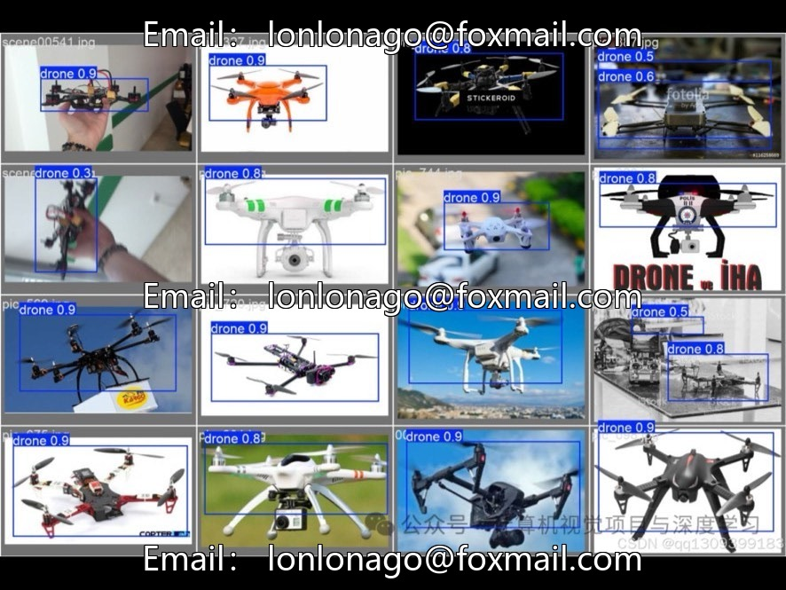
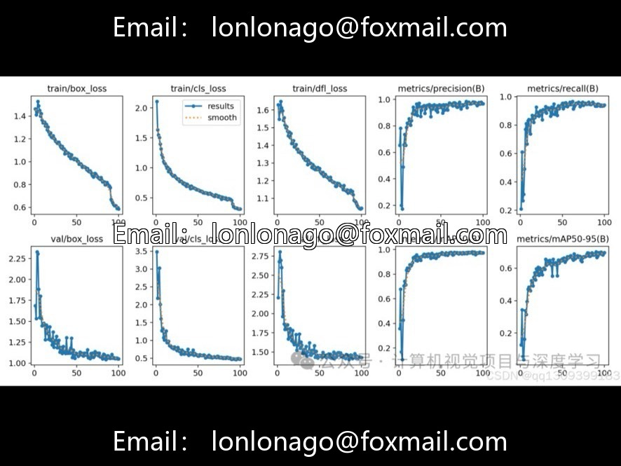
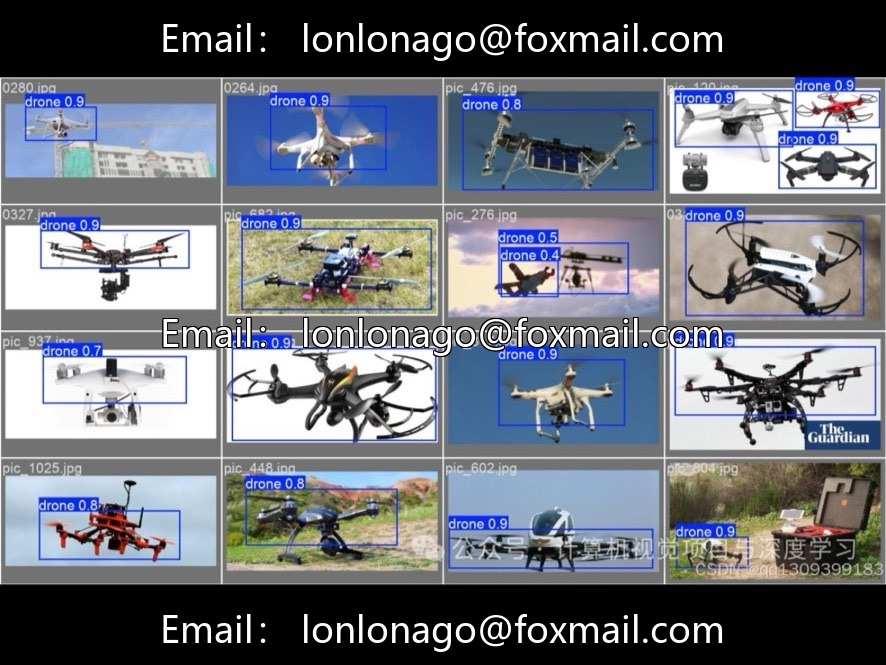

# Based on the summary of YOLOv8 real-time detection technology for drones, including drone target detection.

## Body

Based on the summary of YOLOv8 real-time detection technology for drones, including the full process of drone target detection, it is suitable for research in computer vision, object detection, and low-altitude control.

Main Content
- Research Background: Security risks such as drone airspace intrusions and privacy leaks, the cost-effectiveness and high real-time performance advantages of YOLOv8 machine vision detection.
- YOLOv8 algorithm advantages: Released in 2023, featuring CSPDarknet backbone, Anchor-free, adaptive loss, Mosaic enhancement, and Jetson devices achieving 60FPS+ inference speed.
- Challenges in detection and optimization strategies: Long-distance small targets, complex backgrounds, real-time performance, multi-target tracking.
- Datasets and training: VisDrone2022, UAVDT+custom data, random scaling, motion blur, illumination changes, YOLOv8n/s/m training, TensorRT acceleration.

- Measured Performance: YOLOv8n mAP 68.2%, YOLOv8s mAP 75.6%, YOLOv8m mAP 97.8%
- Field Applications: Airport, Nuclear Power Plant, Event Flight Prohibition Area Alerts, Smart City Low-Altitude Control, Drone Collision Avoidance and Navigation
- Future Directions: Radar + Infrared Fusion, Model Lightweighting, SLAM Trajectory Prediction
- Includes Python source code, supports real-time camera reading, target inference, scene labeling, can be directly run for debugging and testing.

Virtual materials, once sold, are non-refundable.

Interested friends, click "I want".

## Images

## Payment

Here is a pay link on Stripe ( https://buy.stripe.com/3cs8yP7sY87d0vu9AB ). Please contact me lonlonago@foxmail.com after funding $89, and I will send you a complete data files , thank you!

